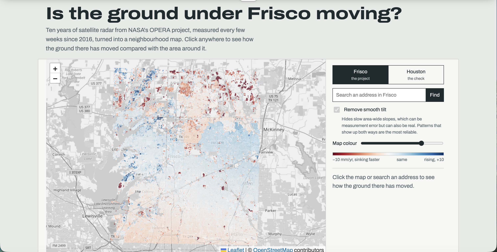

# ground-watch

**Is the ground under Frisco, Texas moving?** A map built from ten years of NASA satellite
radar (2016–2025) that shows which neighbourhoods are sinking or rising compared with the area
around them, checked against Houston, where sinking is well documented.

**Live site:** https://RRMaker.github.io/ground-watch/



## What it does

- Shows a colour map of ground motion over Frisco (red = sinking faster than the area, blue =
  rising or sinking more slowly), on top of a street map.
- Click anywhere, or search an address, to get a plain-language reading for that block of ground
  (about 450 m across) and a chart of how it moved over ten years.
- Switch to Houston to see the check: the method finds the sinking near Katy and northwest
  Houston that researchers have measured.
- A "remove smooth tilt" toggle shows which patterns hold up either way.

## What I found

- **Most of Frisco moves about the same as its surroundings.**
- **Parts of the north of the map are sinking a few millimetres a year relative to the rest**, with
  some small patches sinking faster. I have not shown why; possible causes include new
  construction and settling fill, but this data alone can't tell.
- **Houston check:** before looking, I wrote down that the map had to show more sinking in the
  northwest and north than downtown and the southeast. It does, with the strongest sinking just
  west of the Addicks and Barker reservoirs (near Katy), matching published research and NASA/ASF's
  displacement portal.

## How it works

Data: NASA JPL's [OPERA DISP-S1](https://www.earthdata.nasa.gov/data/projects/nsite/solutions/opera-north-america-disp-product-suite)
surface displacement product (from ESA's Sentinel-1 radar satellites), downloaded from the Alaska
Satellite Facility with `earthaccess`.

1. `pipeline/remote_crop.py` downloads each satellite pass (about 345 MB each), cuts out the
   region, and deletes the big file, keeping only a small crop. Stalled downloads time out and
   retry. Frisco: 171 passes; Houston: 124.
2. `pipeline/build_velocity.py` links OPERA's separate data batches (each measured from its own
   reference date) into one record, keeps only pixels OPERA marks as reliable, removes the
   area-wide shift on each date, and fits a trend plus a yearly seasonal swing (North Texas clay
   swells and shrinks) to every pixel.
3. `pipeline/export_web.py` reprojects the results for web maps and writes `docs/data/`.
4. `docs/index.html` is the site: plain HTML and JavaScript with Leaflet, hosted on GitHub Pages.

### Problems I hit and how I fixed them

- **A fake 20 mm/yr sinking signal.** My first Frisco result said the whole city was sinking
  2 cm a year. The time series showed the whole area jumping together by tens of millimetres
  between passes, which ground can't do; it comes from the atmosphere and the satellite's
  far-away reference point. Fix: measure each place relative to the area's typical motion.
- **Too much noise with 2.5 years of data.** Houston found sinking in the right place but about
  four times too fast compared with ASF's portal. Humid air adds smooth fake patterns, and 2.5 years
  wasn't enough to average them out. Fix: use the full record back to 2016.
- **A rule I changed, and why.** I planned to use the tilt-removed map if Katy still stood out
  after removing the tilt. It did, but removing the tilt also erased the broad northwest-Houston
  sinking that research documents, so it removes real signal. The plain map is the default and the
  tilt-removed version is a toggle.

## Limits

- Readings are **relative to the surrounding area**, so the map can't say whether all of Frisco
  is rising or sinking.
- **Neighbourhood trends, not a diagnosis of any house.**
- Motion is measured along the satellite's slanted line of sight: mostly vertical, with some
  east-west motion mixed in.
- Differences under about 1.5 mm/yr are reported as "about the same".
- It shows where and how much, **not why**.

## Run it yourself

Needs Python 3.11+ and a free [NASA Earthdata](https://urs.earthdata.nasa.gov/) account.

```
python -m venv .venv && source .venv/bin/activate
pip install earthaccess h5py numpy rasterio matplotlib requests
python pipeline/remote_crop.py frisco --download --every 2 --start 2016-01-01 --end 2026-10-31
python pipeline/build_velocity.py frisco
python pipeline/build_velocity.py frisco --deramp
python pipeline/remote_crop.py houston --download --every 4 --frame F08882 --start 2016-01-01 --end 2026-10-31
python pipeline/build_velocity.py houston --frame F08882 --coarsen 3 --cell 900
python pipeline/build_velocity.py houston --frame F08882 --coarsen 3 --cell 900 --deramp
python pipeline/export_web.py
python -m http.server 8000 --directory docs   # then open http://localhost:8000
```

The downloads take hours on home Wi-Fi; everything after that takes minutes.

## How I used AI

I built this with heavy help from Claude, an AI assistant. It wrote most of the pipeline and
website code and explained the radar and InSAR concepts. I ran every step, found the problems
by looking at the output (the fake area-wide sinking, the too-fast Houston numbers, the frozen
downloads), compared results against NASA/ASF's portal, and made the calls about what to trust
and what to show. I can walk through what each script does.

## Credits

Ground-motion data: NASA JPL OPERA, contains modified Copernicus Sentinel data, via ASF DAAC.
Base map © OpenStreetMap contributors. Address search: OpenStreetMap Nominatim.
Built for Hack Club's Stardance challenge.